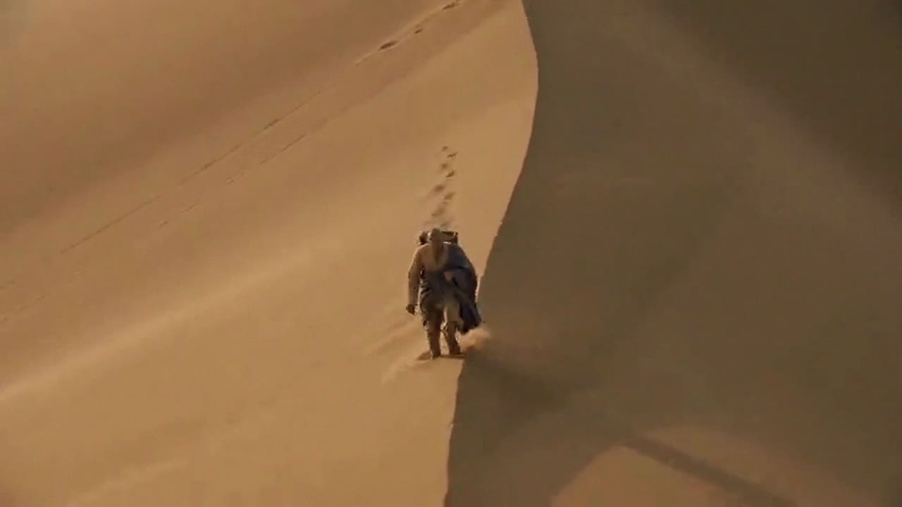

# 导演流水线技能包（AI 短片）

把一支 AI 短片从"想法"做到"能交片"的完整流程：六阶段门禁、提示词工程、成本控制、后期配方。
整套只用 Markdown + Python，**不绑定任何模型或生成平台**——换平台只换工具，不改流程。

## 适合谁 / 不适合谁
- 适合：90–125 秒的 AI 短片（作业、宣传片、商单），预算有限、要求"比同类明显好一截"
- 不适合：真人实拍、超 3 分钟长片、需要专业配音演员的项目

## 效果预览
以下截图来自本流程产出的一支 100 秒历史题材 AI 短片（练习项目，不含个人信息）：





## 快速开始（5 分钟）
1. 读 `SKILL.md` 第 0 节，把启动提示词粘给你的 AI 助手
2. 复制 `templates/01`–`06` 到你的项目文件夹，按顺序填
3. 按 `SKILL.md` 第 7 节清单确认生成平台的单价/模式/失败特征
4. 后期跑 `scripts/post_make.py`（先看 `examples/smoke_test/README.md` 验证环境）

> ⚠ **用前必读**：`scripts/post_make.py` 顶部的 `SEGS` 是**示例镜头清单**（clip01 / 卡1 / clip02 / 卡B）。
> 脚本**不会自动扫描** `生成/` 里的全部片段，必须按你的镜头文件、时长、顺序改 `SEGS`，否则只会拼示例里的四段。
> 示例：
> ```python
> SEGS = [
>     (os.path.join(G, "shot01.mp4"), 8, "s01"),
>     (os.path.join(H, "卡1.png"),    3, "s02"),
>     (os.path.join(G, "shot02.mp4"), 9, "s03"),
>     # ……按成片顺序继续
> ]
> ```

## 依赖
- Python 3.9+，`pip install -r requirements.txt`（只有 Pillow）
- ffmpeg / ffprobe（外部二进制，需自行安装；脚本可用环境变量 `FFMPEG` 指定路径）
- 中文字体：默认读 `C:/Windows/Fonts/`（楷体/宋体），非 Windows 用环境变量 `FONT_DIR` 指向含中文字体的目录

### 字体配置示例
```bat
:: Windows（默认，一般不用配）
set FONT_DIR=C:\Windows\Fonts
:: macOS
export FONT_DIR=/System/Library/Fonts
:: Linux（先装中文字体，如 Noto CJK）
export FONT_DIR=/usr/share/fonts/opentype/noto
```
字体文件名不匹配时，直接指定完整路径（优先级最高）：
```bat
set FONT_KAI=D:\fonts\NotoSerifCJKsc-Bold.otf
set FONT_SONG=D:\fonts\NotoSerifCJKsc-Regular.otf
set FONT_EN=D:\fonts\EBGaramond-Regular.ttf
```

### 运行方式
在**项目目录**里运行脚本（脚本默认从当前目录找 `生成/` 与 `后期/`），或用环境变量 `PROJECT_DIR` 指定项目目录。

## 目录结构
```
README.md           本文件
SKILL.md            主流程（六阶段+门禁、提示词工程、花钱铁律、质检、后期配方、换平台清单、复盘）
LICENSE             MIT（版权人 EasonGYX）
requirements.txt    Python 依赖
templates/          六份模板：脚本/分镜/配音字幕/角色配色/提示词/记账
scripts/            四个脚本：contact_sheet / make_cards / make_cover / post_make
examples/           冒烟测试（2 段 3 秒视频 + 4 张卡 + 2 张测试图 + 1 张封面）
```

## 脚本的输入输出
| 脚本 | 输入 | 输出 | 环境变量 |
|---|---|---|---|
| `contact_sheet.py` | 若干图片 | 一张拼图（等比+黑边，不变形） | — |
| `make_cards.py` | 无（改顶部常量：章节/引文/出处） | 卷目卡 + 引文卡 PNG | `CARDS_DIR`、`FONT_DIR` |
| `make_cover.py` | 可选背景图 | 封面 JPG/PNG | `COVER_TITLE`、`BYLINE`、`SCHOOL`、`COVER_EN`、`COVER_BG`、`FONT_DIR` |
| `post_make.py` | `生成/` 里的视频片段 + `后期/` 的卡 | `成片_无音轨中间片.mp4` | `PROJECT_DIR`、`FFMPEG` |

## 声音分工（重要）
Python 只产出**无音轨的视频中间片**。配音、字幕校准、BGM、最终导出在**剪映**完成：
导入中间片 → 导入 SRT → **用单独的配音稿做文本朗读（不要选中双语字幕朗读）** → 加 BGM → 导出。
（`post_make.py` 的中间片段全部无音轨，避免混合流在拼接时被静默丢弃；`examples/smoke_test` 会断言这一点。）

## 方法来源
- 七段式视频提示词、弱点九项、"38%/62% 构图"等启发式，参考 X 用户 **Eian（@EianLu）** 的公开长文《Claude code/Codex+Seedance AI视频：从一个想法到成片的全流程》（2026-11）：https://x.com/EianLu/status/2118317430665613741 。本项目仅以自己的话转述方法、不复制原文；这些条目在文档中标注为【外部方法·建议】。
- 其余内容（六阶段门禁、串行一验、失败即停、记账规则、卷目卡/封面/拼接脚本）来自本项目的实际制作与返工复盘，标注为【本项目经验】。

## 已知限制
- 生成平台的单价、并发上限、失败率会变，文档不写死价格
- 模板里的"唐代历史写实风"只是示例风格，换成你的题材
- 字幕时间轴需要按成片手动校准（流程见 `templates/03`）

## 开发说明
本项目在 DeepSeek Harness（DSH）中由 AI 助手协助开发、由作者 EasonGYX 决策与验收。AI 工具不作为版权人（见 LICENSE）。

## 许可
MIT，版权人 EasonGYX（见 LICENSE）。
范围说明：MIT 只覆盖本项目自身内容；Eian 原文及其他第三方内容不适用本许可，仍受原作者许可约束。
